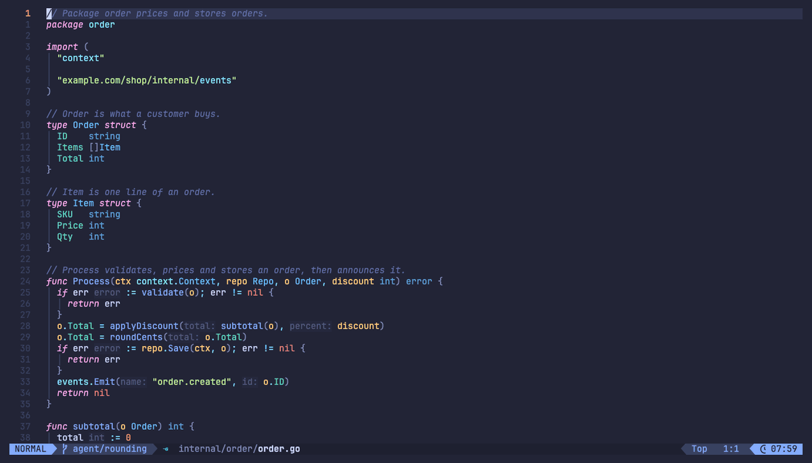

# spoor.nvim

Follow the trail through a codebase without leaving LazyVim. spoor shows who calls the function under your cursor and what it calls, keeps the path you walked with your notes, and tells you which functions your coding agent just added that nothing calls yet. It uses your language server and git, with no AI and no index to build.



A *spoor* is an animal's trail. Experienced programmers read unfamiliar code the same way: pick a focus, look at its neighbours, follow one path, and write down what they learn. The slow part is not following calls but losing the trail. spoor makes that cheap:

- **Live bow-tie.** Callers on the left, the function in the middle, callees on the right. It follows the cursor in a small panel at the bottom, and `gag` opens a float two levels deep.
- **Trace mode.** `gat` walks one hop at a time while the code opens beside you. Add notes as you go and resume the trail tomorrow with `<leader>ct`.
- **What did the agent change?** `<leader>cG` lists the functions touched since the branch point, each with its bow-tie. A new function with no callers is flagged, because that is often the first sign an agent went off track.
- **Entry points.** `<leader>ce` finds `main` functions, HTTP routes, Next.js pages and route handlers, Flutter `main → runApp`, and package scripts. Picking one starts a trace there.
- **Honest edges.** Calls marked `◇3` go through an interface with three implementations. `~` marks a function passed as a value, such as a handler or callback. `</>` marks JSX. Framework-invoked roots such as a Next.js page or a Flutter `build()` get a `⚑` row naming the framework instead of an empty callers column, and everything else is labelled *static calls only*.
- **Less noise.** Vendor code, SDKs, `node_modules` and generated files are hidden but counted, and `H` shows them.

There is no whole-repo graph view. A graph seeded from your cursor, one or two hops deep, teaches more than a hairball. (The [research notes](#why-a-bow-tie) explain this.)

## Install

You need Neovim 0.11 or newer, [snacks.nvim](https://github.com/folke/snacks.nvim) (LazyVim ships it), git, and a language server with call hierarchy. gopls, vtsls, tsgo, dartls, pyright, jdtls, clangd and rust-analyzer all qualify. spoor is tested on macOS and Linux.

### LazyVim or lazy.nvim

Add one file:

```lua
-- ~/.config/nvim/lua/plugins/spoor.lua
return {
  "Matthew-Eucaristo/spoor.nvim",
  version = "*", -- follow releases; drop this line to track main
  event = "VeryLazy",
  opts = {},
}
```

Restart Neovim and lazy.nvim installs spoor and snacks.nvim (declared in spoor's own `lazy.lua`). Open a code file and rest the cursor on a function. `:checkhealth spoor` shows what your language servers support.

### Neovim 0.12's built-in `vim.pack`

```lua
vim.pack.add({ "https://github.com/folke/snacks.nvim", "https://github.com/Matthew-Eucaristo/spoor.nvim" })
require("spoor").setup()
```

### Any other way

Put spoor and snacks.nvim on your `runtimepath` (for example, `git clone` both into `~/.local/share/nvim/site/pack/plugins/start/`) and call `require("spoor").setup()`. Without `setup()` only the `:Spoor` command exists, with no keys and no live panel.

### Why not Homebrew?

A plugin is installed by your plugin manager, which also updates it, pins it in `lazy-lock.json` and loads it lazily. A Homebrew formula would be a second update channel that LazyVim can't see: lazy.nvim resets the runtimepath, so a plugin under Homebrew's `share/nvim/site` is not even loaded. If spoor grows a command-line tool, that tool will ship through Homebrew.

## Keys

Every key below was checked against LazyVim 16, its language extras (including Java's `<leader>cg` group), and the fzf and telescope picker extras, and none collide. `gag` and `gat` join LazyVim's `gai`/`gao` in the `ga` "calls" group.

| Key | What it does |
|---|---|
| `<leader>uB` | Turn the live bow-tie on or off. The choice is remembered. |
| `gag` | Open the bow-tie float at the cursor, two levels deep |
| `gat` | Start a trace at the cursor |
| `<leader>ct` | Resume the last trail in this project |
| `<leader>cT` | Pick a trail (`<c-x>` deletes one) |
| `<leader>ce` | Open the entry-points picker |
| `<leader>cG` | List changed symbols since the branch point (`:Spoor changes <ref>` picks another ref) |

In the bow-tie (panel or float):

| Key | What it does |
|---|---|
| `<CR>` | Jump to the node under the cursor |
| `h` / `l` | Move to the callers or the callees column |
| `<Tab>` | Open one more level from the node, or fold it again. In the panel, this opens the float. |
| `.` / `<BS>` | Re-root on the node, or go back (float) |
| `t` | Start a trace at the node |
| `H` | Show or hide external, generated and test code |
| `R` | Retry, or find callers on servers where live mode skips them |
| `y` | Copy the bow-tie as Mermaid |
| `q` | Close the float. In the panel, `q` turns live mode off and `:q` pauses it for this session. |
| `g?` | Show help |

In trace mode:

| Key | What it does |
|---|---|
| `1`–`9` / `<CR>` | Take that hop. On an interface, pick the implementation. |
| `<BS>` | Step back |
| `n` | Add a note to the step under the cursor (the newest by default) |
| `i` | Switch next hops between callees and callers |
| `<C-q>` | Send the trail to quickfix, notes included |
| `m` | Copy the trail as Mermaid |
| `q` | Close (the trail is already saved) |
| `g?` | Show help |

All global keys can be changed or turned off: `opts = { keys = { changes = "<leader>gC", trace = false } }`, or `keys = false` to set none.

## Commands

`:Spoor bowtie | trace | resume | trails | entries | changes [ref] | live [on|off] | graph | trail`

`:Spoor graph` and `:Spoor trail` print the current bow-tie or trail as JSON.

## Languages and frameworks

Call data comes from your language server. Labels for framework-invoked code come from small rules that read only the declaration and the first lines of the file:

| | Recognized as invoked by something other than your code |
|---|---|
| Go | `main` in `package main`, `init`, `Test*`/`Benchmark*`/`Fuzz*`, `net/http` handlers and `ServeHTTP`, gin/echo/fiber handlers |
| Next.js / React | `app/**/page`, `layout`, `template`, `error` and the other special files, `route.ts` verbs, `pages/` and `pages/api`, `middleware`, `"use server"` actions, `generateMetadata` and friends, components rendered via JSX, hooks |
| Flutter / Dart | `build(BuildContext)`, `State` lifecycle methods, `main` |
| Python | FastAPI/Flask-style route decorators, Celery/Dramatiq tasks, pytest tests, `main` |
| JVM | `static void main`, Spring `@*Mapping`/`@Scheduled`/`@EventListener`/`@Bean`, JUnit |

The entry-point picker uses the same knowledge, plus `package.json` `bin`/`main`/`scripts`, `[project.scripts]`, `if __name__ == "__main__":` and Rust `fn main`. Adding a framework means adding one rule in [`frameworks.lua`](lua/spoor/frameworks.lua) and one test.

Static analysis can't see some edges: dependency-injection containers, calls through reflection, and events on a message bus. spoor shows a function with no static callers as `⚠ no static callers · framework or dynamic entry?` instead of an empty column, and it lists value references (`~`) so you can see where a handler gets registered.

## Performance

spoor makes three requests per bow-tie (prepare, incoming calls, outgoing calls), plus implementation lookups for interface calls. Requests are debounced (120 ms), cancelled when the cursor moves on, cached until you edit or save, never sent in insert mode, and capped at 1.5 s, with 15 s allowed while a server is still indexing. Rendering a 60-node bow-tie takes about 0.15 ms, so all of the latency is in the language server. The defaults come from timing real projects (warm server, p95):

| Server | Project | prepare | callees | callers | callers, 2 levels |
|---|---|---|---|---|---|
| gopls 0.21 | Go API, 800 files | 9 ms | <1 ms | 9 ms | 12 ms |
| vtsls 0.3 | Next.js app, 970 files | 51 ms | 10 ms | 16 ms | 1 ms |
| tsgo 7.0 preview | same app | <1 ms | 5 ms | 6 ms | 12 ms |
| pyright 1.1.413 | Python package, 70 files | 2 ms | 2 ms | 11 ms | 32 ms |
| dartls (Dart 3.13) | Flutter app, 1,300 files | 8 ms | 9 ms | **21 s** | — |

dartls answers "who calls this?" with a workspace-wide search that took 14–21 s on a large Flutter app. For dartls, the live panel therefore shows callees immediately and finds callers when you press `R`, with a 20 s limit. `build()` and the other Flutter lifecycle methods never search for callers, because only the framework calls them. You can tune each server under `servers`. Run `bench/callhierarchy.lua` to measure your own projects.

## Configuration

These are the defaults. Pass only what you want to change in `opts`.

```lua
{
  live = {
    enabled = true, -- first-run default; <leader>uB remembers your choice
    debounce = 120, -- ms the cursor must rest
    layout = "bottom", -- "bottom" panel or "float" in the corner
    height = 8,
    max_items = 6, -- rows per side before "+N more"
  },
  float = { width = 0.86, depth = 2, max_items = 12 },
  timeout = 1500, -- per request, ms
  cold_timeout = 15000, -- while a server is still indexing
  max_nodes = 60,
  implementations = true, -- ◇N badges
  max_implementation_lookups = 8,
  references = true, -- "used as a value" sites when there are no static callers
  servers = {
    dartls = { depth = 1, timeout = 20000, live_callers = false },
  },
  hide = { external = true, generated = true, tests = false },
  exclude = {}, -- Lua patterns on project-relative paths, e.g. { "^legacy/" }
  frameworks = true,
  trace = { width = 58, max_hops = 9 },
  changes = { base = nil, max_files = 60 }, -- base: a git ref; default is the branch point
  keys = {
    bowtie = "gag", trace = "gat", resume = "<leader>ct", trails = "<leader>cT",
    entries = "<leader>ce", changes = "<leader>cG", toggle = "<leader>uB",
  },
}
```

Highlight groups (`SpoorFocus`, `SpoorName`, `SpoorLoc`, `SpoorEdge`, `SpoorInterface`, `SpoorValue`, `SpoorFramework`, `SpoorWarn` and others) link to standard groups, so spoor follows your colorscheme. Icons come from mini.icons, like the rest of LazyVim.

## Files and uninstall

spoor writes only to `stdpath("state")/spoor/` (`~/.local/state/nvim/spoor/` by default):

- `state.json` holds whether the live bow-tie is on.
- `trails/<project>-<hash>.json` holds your trails and notes for each project.

To uninstall with lazy.nvim, delete `lua/plugins/spoor.lua`, run `:Lazy clean`, and delete that folder. spoor never writes to your project, never starts background processes (it only runs short `git` commands), and makes no network requests.

## Building on it

The bow-tie and the trail are plain data with the same JSON shape a future CLI will use:

```lua
require("spoor").current_graph()
-- { version = 1, focus = "internal/order/order.go#24:5", server = "gopls",
--   nodes = { { id, name, kind, path, range, selection, tags, impls?, framework? } },
--   edges = { { from, to, kind = "call"|"jsx"|"ref", sites, source = "lsp" } } }

require("spoor").current_trail()
-- { version = 1, title, steps = { { name, kind, path, line, via, note, framework } } }
```

`User SpoorTrail` fires every time a trail is saved. Paths are relative to the project root. This is the hook for anything layered on top, for example an optional explainer that must cite these nodes. Nothing like that ships in spoor.

## Why a bow-tie

Field studies put about 58% of developer time into comprehension ([Xia et al. 2018](https://research.monash.edu/en/publications/measuring-program-comprehension-a-large-scale-field-study-with-pr/)). Developers who succeed investigate methodically and write down what they find ([Robillard et al. 2004](https://doi.org/10.1109/TSE.2004.101)). Tools have long answered "who calls this?" one hop at a time, but they rarely help you hold one flow in view ([Sillito et al. 2008](https://open.library.ubc.ca/collections/831/items/1.0052042)). Whole-repo graph views make good screenshots but teach little. Focus-seeded, depth-limited views that you build up yourself have better support ([Kersten & Murphy 2006](https://doi.org/10.1145/1181775.1181777), [DeLine et al. 2010](https://doi.org/10.1145/1787234.1787250)). spoor is that idea at the size of one editor panel.

## Development

```sh
make test     # unit and integration tests (mini.test, an in-process fake language server)
make e2e      # real gopls and vtsls/tsgo on tests/fixtures
make smoke    # spoor inside real configs: no plugin manager, plain lazy.nvim, stock LazyVim
make lint     # stylua --check
demo/run.sh   # a throwaway LazyVim (all state under .tests/demo) with this checkout on a demo repo
demo/capture.sh  # re-record demo/hero.gif from that LazyVim (needs node, ffmpeg, Chrome)
```

See [CONTRIBUTING.md](CONTRIBUTING.md). spoor is MIT licensed.
